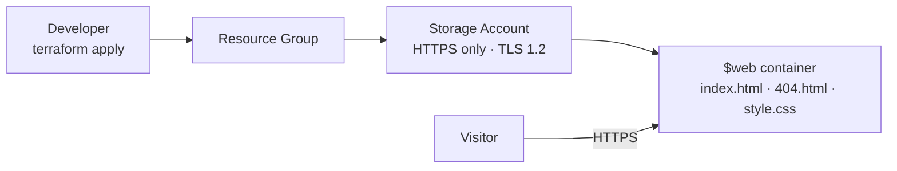

# Terraform Azure Static Website


[](https://github.com/dearley25/terraform-azure-static-site/actions/workflows/terraform.yml)

Infrastructure as Code project that deploys a personal static website to **Azure Storage** using **Terraform**. One command builds everything, one command tears it down.

**Live site:** https://ststaticsiteviakeo.z13.web.core.windows.net/

## What it builds



| Resource | Purpose |
|---|---|
| `azurerm_resource_group` | Groups every resource so cleanup is one step |
| `azurerm_storage_account` | StorageV2 account with a hardened security baseline |
| `azurerm_storage_account_static_website` | Turns on static website hosting with index and 404 pages |
| `azurerm_storage_blob` | Uploads every file in [`site/`](site/) with the correct content type |
| `random_string` | Makes the storage account name globally unique |

## Skills demonstrated

- Writing modular Terraform with variables, validation, outputs and pinned provider versions
- Provisioning Azure resources with the `azurerm` provider
- Looping over files with `for_each` and `fileset()`
- Security-minded defaults: HTTPS only, TLS 1.2 minimum, no public blob containers, no secrets in code
- CI with GitHub Actions running `terraform fmt` and `terraform validate` on every push and pull request

## Prerequisites

- [Terraform](https://developer.hashicorp.com/terraform/install) 1.6 or later
- [Azure CLI](https://learn.microsoft.com/cli/azure/install-azure-cli)
- An Azure subscription ([Azure for Students](https://azure.microsoft.com/free/students) works)

## Deploy

1. Sign in to Azure and point Terraform at your subscription.

   ```bash
   az login
   export ARM_SUBSCRIPTION_ID=$(az account show --query id -o tsv)
   ```

   On Windows PowerShell:

   ```powershell
   az login
   $env:ARM_SUBSCRIPTION_ID = az account show --query id -o tsv
   ```

2. (Optional) Copy `terraform.tfvars.example` to `terraform.tfvars` and change the name or region.

3. Build it.

   ```bash
   terraform init
   terraform plan
   terraform apply
   ```

4. Open the `website_url` shown in the output.

To change the site, edit the files in [`site/`](site/) and run `terraform apply` again. Terraform only re-uploads files whose content changed.

## Clean up

```bash
terraform destroy
```

This deletes the resource group and everything in it.

## Cost

A small static site on Standard LRS storage typically costs only a few cents per month. Run `terraform destroy` when you're done to stop all charges.

## Project structure

```
.
├── .github/workflows/terraform.yml   # CI: fmt + validate
├── site/                             # Website files uploaded to Azure
│   ├── index.html
│   ├── 404.html
│   └── style.css
├── main.tf                           # Resources
├── variables.tf                      # Inputs with validation
├── outputs.tf                        # Website URL and resource names
├── versions.tf                       # Terraform and provider versions
└── terraform.tfvars.example          # Example inputs
```

## Roadmap

- [ ] Remote state in Azure Storage with state locking
- [ ] Security scanning with Checkov in CI
- [ ] Custom domain and HTTPS certificate through Azure Front Door
- [ ] Refactor into a reusable module with `dev` and `prod` environments

## Author

**Deonta Earley**
